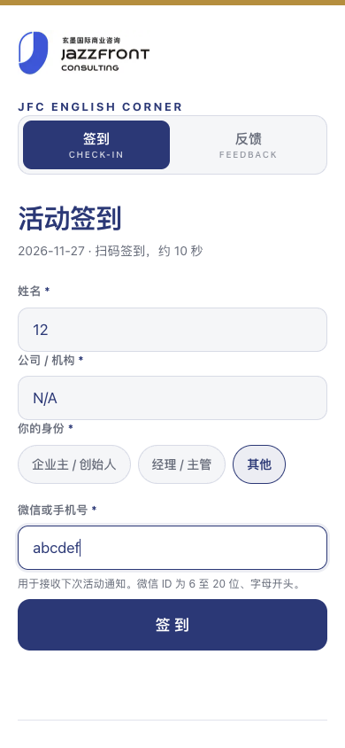
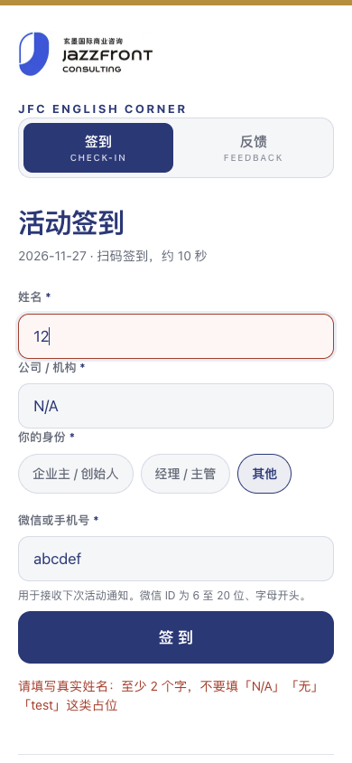
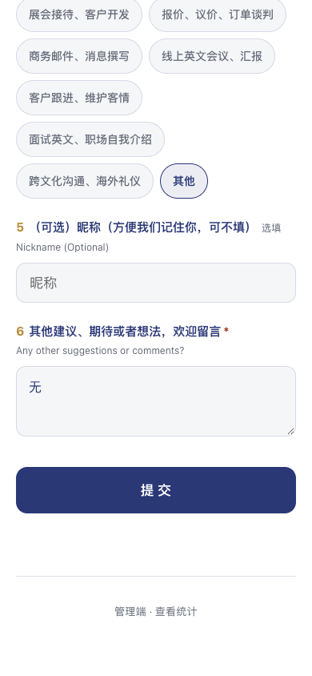
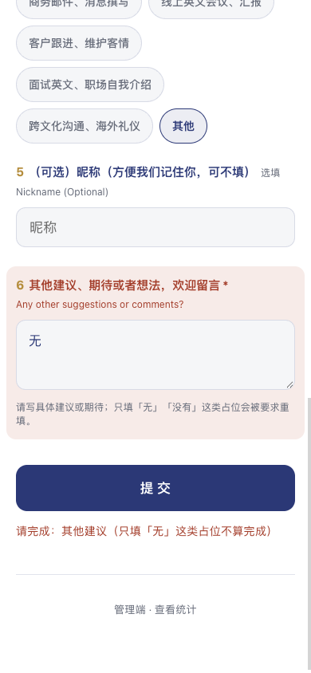
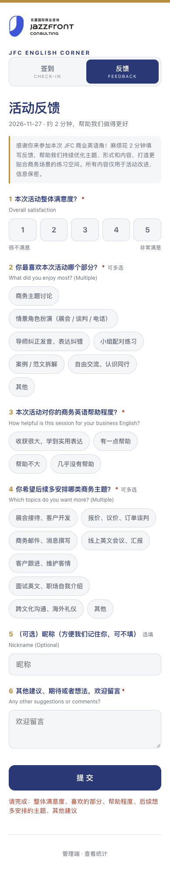
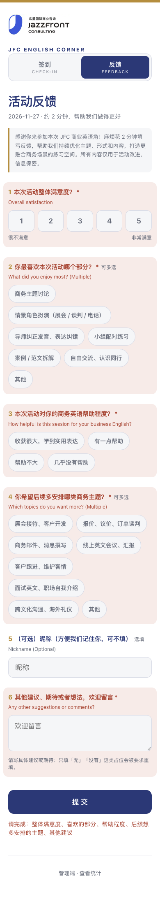
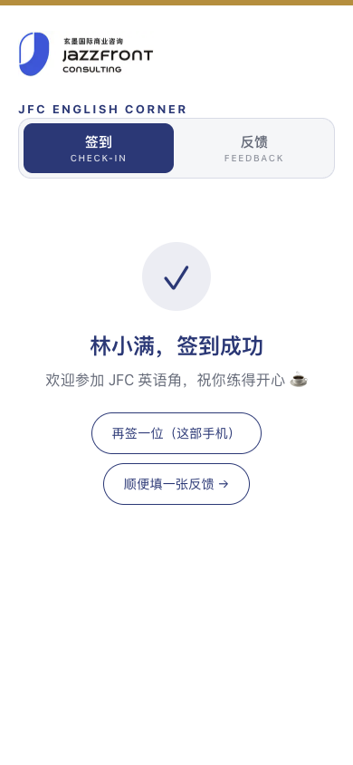
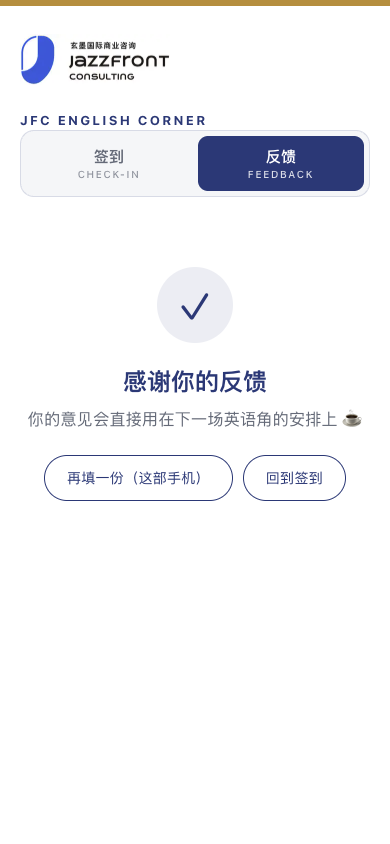

# 英语角签到 / 反馈：必填护栏加固（占位值不再算「填了」）

> 2026-11-27 · 对应 Feishu 需求：「对英语角签到和反馈表进行更新，必填选项被绕过了
> 对所有选项进行加强护栏」。
> 线上落点：`~/Desktop/待办事件/df/`（DataFusion 借道部署；英语角文件列在
> `df/.git/info/exclude`，不入 DF 仓库，故源码集中在本目录归档）。

## 必填是怎么被绕过的 —— 实测证据

旧版（2026-11-24 部署）只校验「有没有值」与一小组中文占位词，以下都能成功落库：

| # | 输入 | 旧版结果 | 说明 |
|---|---|---|---|
| 1 | 公司 = `N/A` | 200 落库 | 线上 2026-11-26 的 `Hikki` 记录就是 `N/A`；词表只有中文占位词 |
| 2 | 姓名 = `12`、公司 = `。。` | 200 落库 | 纯数字 / 纯标点也算「填了」 |
| 3 | 姓名 = 两个零宽空格（`\u200b\u200b`） | 200 落库 | 看不见的字符不算内容，但躲过了「非空」检查 |
| 4 | 微信 = `abcdef` | 200 落库 | 符合微信 ID 正则，但明显不是真人 |
| 5 | `session` = `test` / `1900-01-01` | 200 落库 | 客户端可任意填场次：污染按场次统计，还绕开「同场次 + 同联系方式」去重 |
| 6 | 反馈「其他建议」= `无` / `test` / `。。。` / `123` | 200 落库 | 必填题用占位值就绕过了；数字还会被转成字符串后通过 |
| 7 | 反馈整卷不填就点提交 | 仅一行文字提示 | 不定位是哪些题，缺 5 题也只是平铺列表 |

## 加固后的规则（前后端同一套口径，后端为准）

**签到**（`checkin.py` + 模板）

- 姓名 / 公司 / 联系方式 / `session`：类型必须是字符串，数字、布尔、对象直接拒。
- 姓名、公司：至少 2 个可见字符、必须含字母或汉字、不能是占位词（归一化后挡
  `N/A`、`n.a.`、`无`、`暂无`、`保密`、`匿名`、`test` 等）、不能是单字符反复；
  零宽/方向控制符等不可见字符既不计数也会在落盘前清掉。
- 联系方式：格式口径不变（11 位手机 / 6–20 位字母开头微信 ID）；另拒绝全同字符、
  含 `test/fake/dummy/example` 字样、`13800138000` 等经典测试号、后十位全同的手机号。
- `session`：必须是 `YYYY-MM-DD` 的真实日期，且在本场次前后一年内（断网补传的
  旧场次仍可用；`test`、`1900-01-01`、`2026-02-30` 一律拒）。
- `role` / `source` / `first_time` 白名单不变。

**反馈**（`feedback.py` + 模板）

- 必填口径不变：满意度、喜欢的部分、帮助程度、想多安排的主题、其他建议；
  昵称按腾讯问卷原卷仍为选填。
- 「其他建议」：至少 2 个可见字符，拒绝占位词（`无`/`没有`/`暂无建议`/`不知道`/
  `test`/`ok`/`123`…）、纯数字、纯标点、单字符反复、零宽字符。
- 昵称：选填；若填写必须是字符串、≤40 字、非占位词；emoji 昵称放行（不要求含字母）。
- `session` 校验同签到；满意度 1–5、帮助程度白名单、多选白名单/去重不变。

**前端交互**

- 签到：错误提示更具体；出错的字段整栏加红框，重新输入即清除。
- 反馈：未完成 / 占位的题整题淡红底，并自动滚到第一处；只标真正没答对的题
  （选填昵称不标）；点选或输入后立即清标记；「其他建议」下方常驻提示
  「只填『无』这类占位会被要求重填」。
- 输入框加 `maxlength`（姓名 40 / 公司 80 / 联系方式 60 / 昵称 40 / 留言 1000）。

## Before / After

**Baseline**：2026-11-24 部署版 `/checkin`（旧代码，`ec-checkin-feedback` 分支
`8dedc43` 之后、本 PR 之前；在 8899 沙箱用旧文件渲染，真实 Chromium 390×844）。
**Changed revision**：本分支 head；已部署到线上 `http://localhost:8888/checkin`。
两边同视口、同主题、同一组输入。

| 签到：同一组敷衍值（姓名 `12` / 公司 `N/A` / 微信 `abcdef`） | |
|---|---|
| Before：直接「签到成功」 | After：拦下并标红，提示填真实姓名 |
|  |  |

| 反馈：其余题都选好、只把「其他建议」填成「无」 | |
|---|---|
| Before：提交成功「感谢你的反馈」 | After：第 6 题标红 + 提示，停在原页 |
|  |  |

| 反馈整卷不填就提交 | |
|---|---|
| Before：一行文字提示，不定位 | After：5 道必填题逐题标红（昵称选填不标） |
|  |  |

| 合法提交仍然可用 | |
|---|---|
| 签到成功 | 反馈成功 |
|  |  |

补充：`screenshots/before-checkin-junk-accepted.png`（旧版整卷敷衍仍成功的签到页）、
`screenshots/before-feedback-junk-accepted.png`（旧版反馈成功页）、
`screenshots/before-checkin-empty-rejected.png`。

## 文件与落点

| 文件 | 部署落点（`~/Desktop/待办事件/df/`） |
|---|---|
| `checkin.py` | `checkin.py`（整文件替换） |
| `feedback.py` | `feedback.py`（整文件替换） |
| `templates/checkin.html` | `templates/checkin.html`（整文件替换） |
| `templates/_ec_logo.html` | 未改动，本次仅为归档完整性附带（线上已有同一文件） |
| `tests/test_checkin.py` | `tests/test_checkin.py`（整文件替换） |
| `tests/test_feedback.py` | `tests/test_feedback.py`（整文件替换） |

`app.py` **无改动**：`/checkin`、`/ec-feedback` 路由与模板变量均已存在，本次只改
两个模块与模板。部署后重启 Flask（launchd 守护会在 ~30s 内自动拉起），
`/checkin`、`/ec-feedback` 均 200。

回滚：把上表文件换回 `ec-checkin-feedback` 分支 `8dedc43` 的版本并重启 Flask。

## 验证

- 单测（全部重定向到临时文件，不碰真实记录）：
  - `framework python3 tests/test_checkin.py` → **32 项通过**（新增占位姓名/公司、
    假联系方式、非字符串、非法场次、占位值绕过 API 等用例）；
  - `framework python3 tests/test_feedback.py` → **37 项通过**（新增占位留言、非字符串、
    占位昵称、emoji 昵称、非法场次、占位值绕过 API 等用例）。
- 浏览器端到端（8899 沙箱 + 线上 8888，真 Chromium 390×844）：
  - 敷衍值提交被拦、标红、提示到具体字段/题目；改正后提交成功；
  - 整卷不填提交：5 道必填题标红、自动滚到第一题；选填昵称不标红；
  - 合法签到/反馈提交仍成功。
- 线上接口：`POST /api/checkin`（`姓名=12`/`公司=N/A`/`微信=abcdef`）→ 400；
  `POST /api/ec-feedback`（留言=`无`）→ 400；合法 payload → 200。验证用记录已即时删除，
  记录数前后一致（签到 17 条 / 反馈 2 条，未改动历史数据）。

## 边界与说明

- **必填口径没有变**：反馈仍按腾讯问卷原卷 6 题（昵称选填）；这次只是让
  「填了占位值」不再算完成。
- **只对新增提交生效**：历史记录里的 `N/A` 等旧数据不回改（导出、统计口径不变）。
- `session` 允许覆盖的窗口是前后一年：覆盖断网补传的旧场次，超出窗口即拒。
- 未做防刷/提交频率限制（本次范围是字段护栏，若需要另开）。
- 现场若觉得「其他建议」太严（如只想写两个字），可放宽 `feedback.py` 的
  `_comment_is_fake()` 最短长度，前后端各一处。
