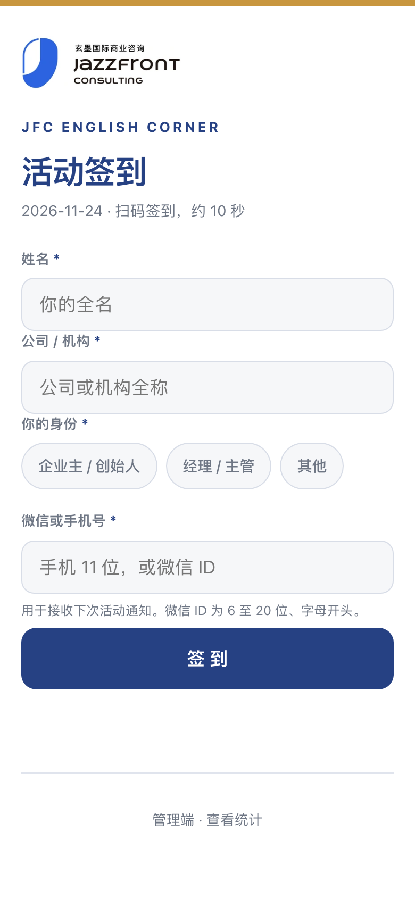
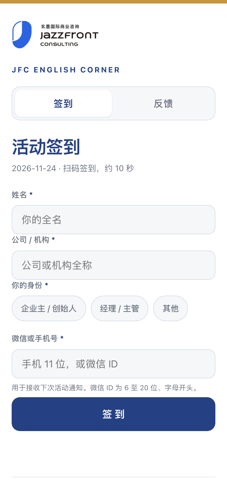
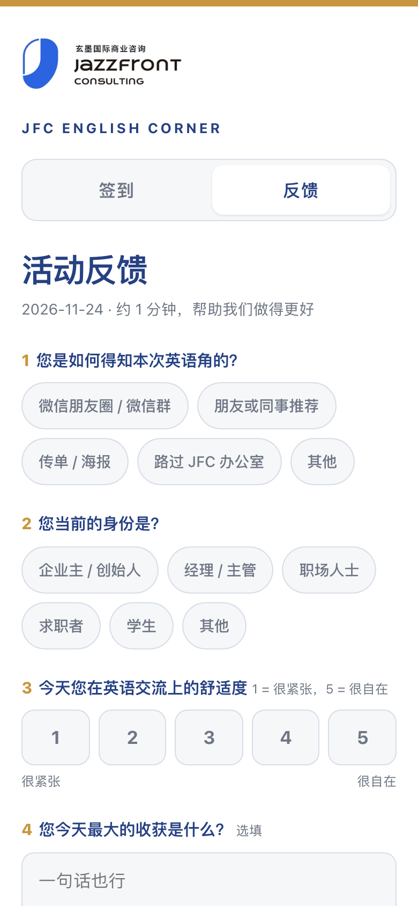
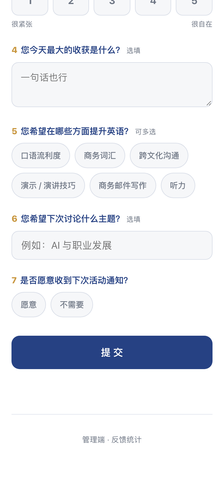
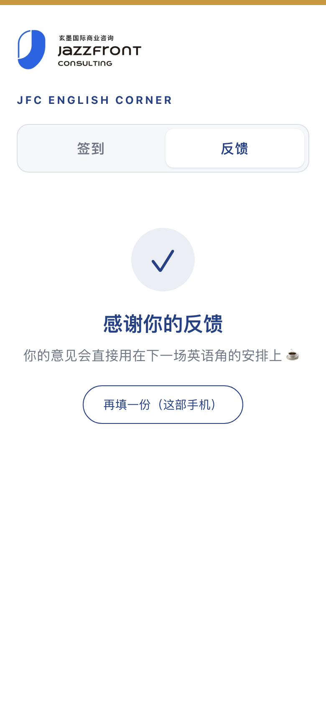

# 英语角签到表：一张二维码，签到 / 反馈可切换

## 这次改了什么

现场原来有两个二维码：`/checkin`（签到）和 `/ec-feedback`（反馈）。现在**签到二维码不变**（`https://datafusion.a.pinggy.link/checkin`），打开后页面顶部多一个「签到 / 反馈」切换条：

- **默认落在签到**，与原来的签到表单完全一致（四项必填、身份 chip、断网队列、现场签到台 `?desk=1`）。
- 点「反馈」切到同一套 7 题问卷（题号、选项、无必填、选「愿意」才展开微信），视觉沿用签到表的 JFC 白底 + 海军蓝 + 金线。
- 反馈提交仍走原来的 `/api/ec-feedback` 和 `feedback.py`，数据没有搬家，管理端统计 / CSV 导出照旧。
- 旧的 `/ec-feedback` 页面**保留**：老海报扫到的反馈码仍然能用，反馈管理端入口也还在。
- `?tab=feedback` 可直接深链到反馈段（便于活动后在群里只发反馈那一段）。
- 签到台（`?desk=1`）与管理端（`#admin`）不显示切换条，行为不变。
- 同一部手机「再签一位 / 再填一份」两个入口都保留。

**二维码内容没有变**：`/checkin` 这个 URL 现在同时承载两段，所以已打印的签到码/桌卡不需要重印；不需要再生成第二张二维码。

## 文件与落点

这些文件是 `~/Desktop/待办事件/df` 本地部署的一部分（英语角板块的模板与测试被 `.git/info/exclude` 排除在 DataFusion-Live 之外），本分支镜像一份改动后的文件，便于评审完整 diff：

| 本分支文件 | 实际部署位置 |
|---|---|
| `templates/checkin.html` | `df/templates/checkin.html`（已在运行中的实例上生效） |
| `tests/test_checkin.py` | `df/tests/test_checkin.py` |
| `app_checkin_route.patch` | `df/app.py` 的 `checkin_page()` 一处的 diff（把 `feedback.py` 的选项白名单传给模板） |

`templates/checkin.html` 与部署文件逐字节一致（sha256 `4af6c985…c2b35`）。

## 验证

- `python3 -m unittest discover -s tests`：**96 项通过**（含新增的「一张页面上两段都在」路由测试）。
- Playwright 在 390×844（另测 320 / 768 宽无横向溢出、无 console 报错）实际点击验证：
  - 切换条默认选中签到；点「反馈」后 URL 变 `?tab=feedback`、两段互斥显示；
  - 反馈 7 题可填、多选可用、选「愿意」才出现微信框；
  - 提交后落库字段正确（`source/role/comfort/takeaway/skills/next_topic/notify/wechat` 均入库）；
  - 提交后切回再切回反馈仍显示已提交页，「再填一份」能复位；
  - 签到提交、`?desk=1`、`#admin` 均正常，后台页不显示切换条；
  - 旧 `/ec-feedback` 仍返回 200 且原表单可用。
- 本地测试库为临时文件，未向生产 `checkin_records.json` / `feedback_records.json` 写入测试数据。

## Before / After

同一场景、同一视口（390×844，2x）：

| Before：只有签到，无切换条 | After：顶部出现「签到 / 反馈」切换条 |
|---|---|
|  |  |

| After：反馈段（上） | After：反馈段（下） |
|---|---|
|  |  |

| After：提交成功 |
|---|
|  |

## 部署注意

Flask 的模板缓存与新加入的模板变量都需要**重启 Flask 进程**后才生效（`debug=False`，模板不会热加载）。本次已在运行实例上重启并复核 `/checkin` 返回新页面。
